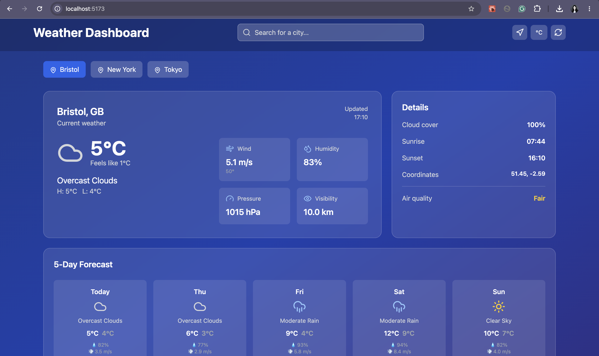

# Weather Dashboard

A full-stack weather app: a REST API built with Express that wraps the [OpenWeatherMap](https://openweathermap.org/api) API, and a React dashboard that displays the data.

The backend keeps the API key private, normalizes OpenWeatherMap's responses into a clean format, and adds validation, error handling, and rate limiting. The frontend consumes only this API and never sees the key.



**Live demo:** https://youtu.be/azttzu-6pJ4

## Features

- Current weather: temperature, feels-like, humidity, wind, pressure, visibility, cloud cover
- 5-day forecast with daily highs and lows
- City search with autocomplete (geocoding)
- "Use my location" via browser geolocation and reverse geocoding
- Air quality index
- Sunrise and sunset shown in the searched city's local time
- Celsius / Fahrenheit toggle
- Responsive layout with a glassmorphism UI

## Tech Stack

| Layer | Technology |
|-------|------------|
| Frontend | React 18, Vite, Tailwind CSS v3, lucide-react |
| Backend | Node.js, Express 4, Axios |
| Security | CORS, express-rate-limit, input validation, API key kept server-side |
| External API | OpenWeatherMap (Current Weather, 5-day Forecast, Geocoding, Air Pollution) |

## Architecture

```
Browser (React, :5173)
   │  fetch('/api/v1/...')
   ▼
Vite dev proxy
   │  forwards /api/*
   ▼
Express API (:3001)  ──►  OpenWeatherMap
   │  validates, normalizes, rate-limits
   ▼
JSON response back to the browser
```

## Project Structure

```
api_project/
├── weather-api/                # Backend
│   ├── server.js               # Express app, routes, OpenWeatherMap calls
│   ├── package.json
│   ├── .env.example            # Template for environment variables
│   └── .gitignore
│
└── weather-dashboard/          # Frontend
    ├── index.html
    ├── package.json
    ├── vite.config.js          # Dev server + /api proxy
    ├── tailwind.config.js
    ├── postcss.config.js
    └── src/
        ├── main.jsx            # React entry point
        ├── App.jsx             # Dashboard UI
        ├── weatherAPI.js       # API client for the backend
        └── index.css           # Tailwind directives
```

## Getting Started

### Prerequisites

- Node.js 20 or newer (22 LTS recommended)
- A free OpenWeatherMap API key from [openweathermap.org/api](https://openweathermap.org/api). New keys can take a while to activate.

### 1. Clone the repo

```bash
git clone TODO-your-repo-url
cd api_project
```

### 2. Start the backend

```bash
cd weather-api
npm install
cp .env.example .env
```

Open `.env` and add your key:

```
OPENWEATHER_API_KEY=your_api_key_here
PORT=3001
```

Then run:

```bash
npm run dev
```

Check it works: <http://localhost:3001/api/health>

### 3. Start the frontend

In a second terminal:

```bash
cd weather-dashboard
npm install
npm run dev
```

Open the URL Vite prints, usually <http://localhost:5173>.

## API Reference

Base URL: `http://localhost:3001/api/v1`

| Method | Endpoint | Query params | Description |
|--------|----------|--------------|-------------|
| GET | `/weather/current` | `lat`, `lon` **or** `city`; `units` | Current weather |
| GET | `/weather/forecast` | `lat`, `lon`; `units` | 5-day forecast |
| GET | `/weather/air-pollution` | `lat`, `lon` | Air quality index and pollutant levels |
| GET | `/locations/search` | `q`; `limit` (max 10) | Search cities by name |
| GET | `/locations/reverse` | `lat`, `lon` | Find a place name from coordinates |
| GET | `/api/health` | none | Health check (outside `/v1`) |

`units` can be `metric` (default), `imperial`, or `standard`.

### Example

```bash
curl "http://localhost:3001/api/v1/weather/current?city=Bristol"
```

```json
{
  "location": {
    "name": "Bristol",
    "country": "GB",
    "lat": 51.4545,
    "lon": -2.5879,
    "timezone": 0
  },
  "current": {
    "temp": 4,
    "feels_like": 1,
    "temp_min": 3,
    "temp_max": 6,
    "pressure": 1021,
    "humidity": 81,
    "visibility": 10000,
    "uv_index": null,
    "wind_speed": 3.6,
    "wind_deg": 240,
    "clouds": 75,
    "weather": {
      "main": "Clouds",
      "description": "broken clouds",
      "icon": "04d"
    },
    "sunrise": 1764056000000,
    "sunset": 1764086000000
  },
  "timestamp": 1764070000000
}
```

(Values are illustrative.)

### Errors

All errors return JSON in this shape:

```json
{ "error": "Location not found" }
```

| Status | Meaning |
|--------|---------|
| 400 | Missing or invalid parameters |
| 401 | Invalid or not-yet-activated OpenWeatherMap key |
| 404 | Location or route not found |
| 429 | Rate limit exceeded (100 requests per 15 minutes per IP) |
| 502 | OpenWeatherMap could not be reached |

## Design Decisions

- **Backend proxy instead of calling OpenWeatherMap from the browser.** The API key stays on the server and never reaches the client.
- **Response normalization.** The frontend gets a stable, simplified shape, so the data source could be swapped or extended with other providers without changing the UI.
- **Forecast aggregation.** OpenWeatherMap's free forecast returns 3-hour steps, which the API groups into daily highs and lows.
- **Race-condition handling.** The frontend ignores stale responses when you switch cities quickly.
- **Graceful degradation.** If the air quality request fails, the rest of the dashboard still loads.

## Troubleshooting

| Problem | Fix |
|---------|-----|
| `Missing OPENWEATHER_API_KEY` on backend start | Make sure `weather-api/.env` exists (not `.env.txt`) and contains your key |
| `401 Invalid API key` | New keys can take up to a few hours to activate |
| "Cannot reach the server" in the browser | Start the backend first, and check the `/api` proxy in `vite.config.js` |
| Page shows no styling | Make sure Tailwind v3 is installed (`npm ls tailwindcss`) and `src/index.css` contains the three `@tailwind` directives |
| `EADDRINUSE` on port 3001 | Another process is using the port. Stop it or change `PORT` in `.env` and update the proxy target |

## Security

- `.env` is git-ignored. Never commit your API key.
- If a key is ever exposed, regenerate it in your OpenWeatherMap account.
- The API is rate-limited per IP to protect your OpenWeatherMap quota.

## Possible Improvements

- Response caching (in-memory or Redis) to reduce external API calls
- Automated tests with Jest and Supertest
- OpenAPI/Swagger documentation
- Hourly forecast and weather charts
- Saved favorite locations
- Docker setup and deployment config

## Acknowledgments

- Weather data from [OpenWeatherMap](https://openweathermap.org/)
- Icons by [Lucide](https://lucide.dev/)

## Author

Andrea Espino · [GitHub](https://github.com/andreeaespino) · [LinkedIn](https://linkedin.com/in/andreaespino)
